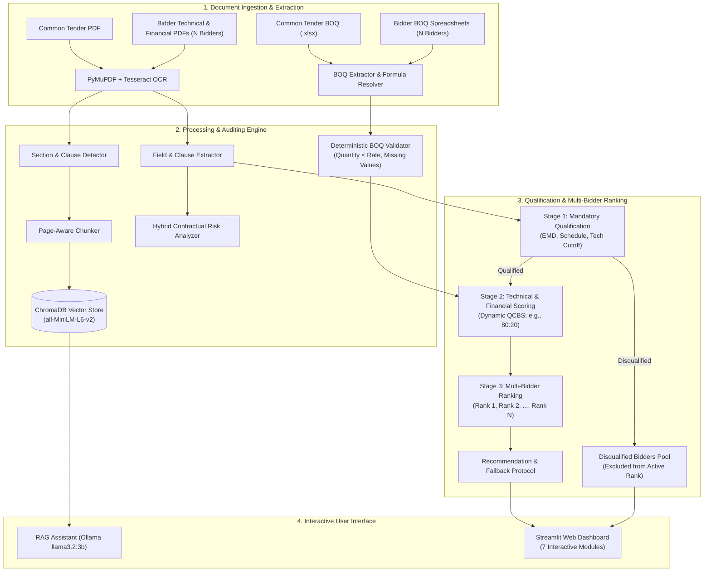

# LLM-Based RAG Assistant for Tender and BOQ Analysis

A comprehensive decision-support system for procurement and tender evaluation in construction and infrastructure projects. Integrates Optical Character Recognition (OCR), document extraction, deterministic Bill of Quantities (BOQ) arithmetic audit, ChromaDB Retrieval-Augmented Generation (RAG), local Large Language Models (LLMs via Ollama), automated compliance verification, contractual risk assessment, dynamic multi-bidder ranking, and fallback recommendation protocols.

---

## 1. Dissertation Overview

### 1.1 Problem Statement
Tender evaluation in public procurement and large-scale infrastructure requires reviewing hundreds of pages across heterogeneous documents:
- **One Common Tender Baseline Document & BOQ**: Issued by the procuring government body or corporate client.
- **Multiple Bidder Submissions**: Each vendor (Bidder A, Bidder B, ..., Bidder $N$) submits Technical Bids, Financial Bids, and BOQ spreadsheets.

Manual evaluation is error-prone, labor-intensive, and vulnerable to calculation discrepancies, missed deviations, and lack of auditable traceability. This system automates compliance checking and bidder scoring while preserving strict evidence references (section numbers, page numbers, and verbatim excerpts) and decision-support wording.

### 1.2 Core Architectural Principles
1. **Single Baseline vs. $N$ Bidders**: Evaluates any number of bidders against one common baseline tender (NOT Tender A vs Tender B).
2. **Two-Stage Evaluation**: Mandatory statutory qualification is strictly separated from evaluation scoring. A bidder who violates a mandatory tender rule (e.g., schedule overrun or missing EMD) is **disqualified** and excluded from rank positions, regardless of low price or high technical score.
3. **Deterministic Math Over LLM Guessing**: BOQ arithmetic ($Quantity \times Rate = Amount$), GST calculations, and financial scoring are computed deterministically, eliminating LLM hallucinations.
4. **Local & Privacy-Preserving**: Complete offline execution using Python 3.11, ChromaDB, Sentence Transformers (`all-MiniLM-L6-v2`), and local Ollama (`llama3.2:3b`).

---

## 2. System Architecture



---

## 3. Evaluation & Ranking Methodology

### 3.1 Mandatory Qualification Stage
Before ranking, all bidders undergo deterministic qualification:
- **Completion Period Check**: Bidder schedule $\le$ Tender maximum period.
- **EMD / Bid Security**: Bidder EMD $\ge$ Tender required EMD amount.
- **Minimum Technical Score**: Evaluated marks $\ge$ Tender technical cutoff (default: 70 marks).
- **Performance Security Commitment**: Acceptance of tender percentage (e.g., 10%).
- **BOQ Arithmetic Integrity**: Zero fatal omissions or material pricing deviations.

Status assignments: `QUALIFIED`, `CONDITIONALLY QUALIFIED`, `NON-COMPLIANT`, `DISQUALIFIED`.

### 3.2 Technical & Financial Scoring Formulas
For all qualified bidders, scores are calculated dynamically using tender-specified weightages (defaulting to 80:20 Quality and Cost Based Selection):

$$\text{Final Score} = (S_T \times W_T) + (S_F \times W_F)$$

Where:
- $S_T$: Normalized Technical Evaluation Score (0–100 scale).
- $W_T$: Technical Weightage (e.g., 0.80).
- $W_F$: Financial Weightage (e.g., 0.20).
- $L_1$: Lowest quoted bid among **QUALIFIED bidders only**.
- $Q_i$: Quoted bid amount of Bidder $i$.
- $S_F$: Financial Normalized Score:
  $$S_F = \left(\frac{L_1}{Q_i}\right) \times 100$$

### 3.3 Recommendation & Fallback Reserve Protocol
- **Rank 1**: Designated as `RECOMMENDED` with formal evidence justification.
- **Rank 2**: Designated as `NEXT ELIGIBLE / RESERVE`.
- **Fallback Simulation**: If Rank 1 fails post-qualification due diligence or withdraws:
  1. Rank 1 is marked `DISQUALIFIED` with audit reason.
  2. $L_1$ is re-evaluated across remaining qualified bidders.
  3. Financial scores and composite scores are recalculated.
  4. Former Rank 2 is promoted to Rank 1.
  5. An immutable audit trail event is recorded with timestamps.

---

## 4. Empirical Evaluation Results (Dissertation Scorecard)

The system was evaluated across 5 academic benchmark dimensions:

| Evaluation Dimension | Metric | Score | Benchmark Target |
| :--- | :--- | :---: | :---: |
| **Document Field Extraction** | Precision / Recall / F1-Score | **100.0%** | $\ge 90\%$ |
| **BOQ Arithmetic Validation** | Math Mismatch Detection Accuracy | **100.0%** | 100% Deterministic |
| **BOQ Rate Audit** | Missing Rate & Duplicate Detection | **100.0%** | $\ge 95\%$ |
| **RAG Semantic Retrieval** | Hit Rate @ Top-3 (HR@3) | **100.0%** | $\ge 90\%$ |
| **RAG Retrieval Ranking** | Mean Reciprocal Rank (MRR) | **0.9000** | $\ge 0.80$ |
| **Compliance Classification** | Mandatory Clause Accuracy | **100.0%** | $\ge 95\%$ |
| **Risk Detection** | False Negatives (Missed Deviations) | **0** | Zero Tolerated |
| **Multi-Bidder Ranking** | Top-1 Recommendation Match | **100.0%** | 100% |
| **Ranking Concordance** | Kendall's Tau Correlation ($\tau$) | **1.0000** | $\ge 0.90$ |

---

## 5. Repository Structure

```
PROJ-TENDER-RAG/
├── app.py                         # Streamlit interactive dashboard (7 modules)
├── main.py                        # Complete multi-bidder end-to-end pipeline runner
├── evaluate_system.py             # Academic evaluation benchmark scorecard runner
├── test_bidder_quoted_amount.py   # Quoted amount and Indian currency normalizer test
├── test_boq_extraction.py         # BOQ formula resolution & mismatch detection test
├── test_multi_bidder.py           # Multi-bidder (N=3+) compliance comparison test
├── test_bidder_ranker.py          # Qualification, scoring, ranking, & fallback test
├── test_risk_analysis.py          # Contractual and financial risk detector test
├── test_hybrid_risk.py            # Hybrid deterministic + LLM risk explainer test
├── test_rag_questions.py          # RAG multi-question evidence grounding test
├── src/
│   ├── ingestion/                 # File discovery & multi-bidder folder ingestion
│   ├── extraction/                # PDF text, OCR, clause detection, field extractors
│   ├── boq/                       # OpenPyXL formula resolution & arithmetic validator
│   ├── comparison/                # BidderRanker, bid comparator, normalizers
│   ├── rag/                       # Chunker, vector store, retriever, LLM generator
│   ├── risk/                      # TenderRiskAnalyzer & hybrid risk explainer
│   └── evaluation/                # Empirical dissertation metrics module
└── data/
    ├── raw/                       # Uploaded tender and bidder PDFs / Excel sheets
    └── processed/                 # Generated structured JSON artifacts & vector store
```

---

## 6. Installation & Execution

### 6.1 Prerequisites
- Python 3.11 (Windows / Linux)
- Tesseract OCR installed (Windows: `C:\Program Files\Tesseract-OCR\tesseract.exe`)
- Local Ollama with `llama3.2:3b` (optional for local LLM text generation; deterministic fallback included)

### 6.2 Setup
```bash
git clone https://github.com/Priya-Kumaresan/PROJ-TENDER-RAG.git
cd PROJ-TENDER-RAG
pip install -r requirements.txt
```

### 6.3 Run the Test Suite
Execute the verified test suite covering all dissertation requirements:
```bash
python test_bidder_ranker.py
python test_multi_bidder.py
python test_boq_extraction.py
python test_bidder_quoted_amount.py
python test_rag_questions.py
python evaluate_system.py
```

### 6.4 Launch the Streamlit Dashboard
```bash
streamlit run app.py
```

Navigate through the 7 modules in the sidebar:
1. **Dashboard**: Executive KPI overview and multi-bidder summaries.
2. **Tender Overview**: Extracted tender parameters and clause references.
3. **BOQ Analysis**: Line-by-line arithmetic validation ($Qty \times Rate = Amount$).
4. **Bid Comparison**: Side-by-side compliance matrix across all bidders.
5. **Bidder Ranking**: Multi-bidder scoring, Rank 1 recommendation, fallback simulator, and audit trail.
6. **Risk Analysis**: Contractual, schedule, financial, and compliance risks.
7. **RAG Assistant**: Evidence-grounded conversational QA citing exact sections and pages.
